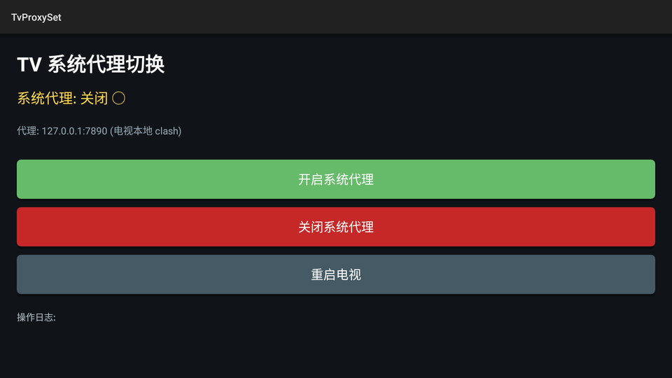

# TvProxySet

海信 VIDAA 电视(Android 9,无 root)上的**系统代理一键开关**。

这台电视没有 VPN 基础组件:`/dev/net/tun` 存在但无 root 无法创建节点,clash 的 TUN 模式用不了;
而所有依赖「系统网络」的 app(影视仓、聚好看、电视自带的浏览器等)如果没有系统代理就直连。
这个 app 做的就是改写 Android 的全局 HTTP 代理设置,并在界面上给出开/关/重启三个动作。

<p align="center">
  
</p>

## 它到底改了什么

| | |
| --- | --- |
| 写入的设置 | `Settings.Global.HTTP_PROXY`(等价于 `adb shell settings put global http_proxy host:port`) |
| 需要的权限 | `WRITE_SETTINGS`(首次运行会跳系统页面让你手动勾选) |
| 默认目标 | `127.0.0.1:7890` — 电视本地 clash 的回环端口 |
| 关闭 | `settings put global http_proxy :0` |
| 生效范围 | 走系统代理的 app;自己写死代理或不认系统代理的 app 不受影响 |

> 单机游戏/流媒体这类 app 常常自己实现网络栈,系统代理对它们无效 —— 这是 Android 的机制,不是本 app 的限制。

## 安装

```bash
adb install -r tvproxy-1.1.0-universal.apk
```

APK 在 [Releases](https://github.com/iam2r/tvproxy/releases) 里,`universal` 版不区分 CPU 架构(本 app 无 native 代码)。
也可以直接拷到电视上用文件管理器安装。

## 用法

1. 打开 **TvProxySet**,首次会要求「修改系统设置」权限,允许;
2. 「开启系统代理」→ 系统代理指向 `127.0.0.1:7890`;
3. 需要换端口时改 `ProxyManager` 里的常量后重新构建,或用 adb 直接写 `settings put global http_proxy 主机:端口`;
4. 「重启电视」用于让少数把代理读进内存的 app 重新取一次设置。

## 图标

线条风格:电视外框(设备)+ 琥珀色圆点(本机 app)+ 薄荷色折线箭头(流量改走另一条路)。
矢量自适应图标 + 320×180 电视 banner,源码在 `app/src/main/res/`。

## 构建

```bash
export JAVA_HOME=/path/to/jdk17
./gradlew assembleRelease
```

签名:设置 `SIGNING_KEYSTORE` / `SIGNING_STORE_PASSWORD` / `SIGNING_KEY_ALIAS` / `SIGNING_KEY_PASSWORD`
四个环境变量时用指定密钥签名,否则用 debug 密钥(可 ADB 侧载,但不适合发布更新)。CI 里这四个值来自仓库 Secrets。

## 许可

MIT,见 [LICENSE](LICENSE)。
